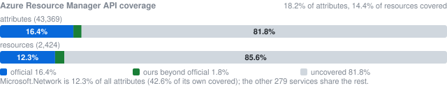
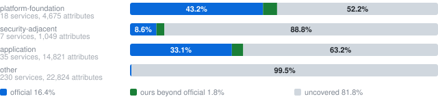
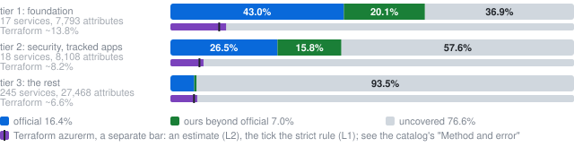

# aso-extensions

Kubernetes kinds for Azure that
[Azure Service Operator v2](https://github.com/Azure/azure-service-operator)
(ASO) does not have, or has without a field an application needs. They run
on ASO's own reconciler framework and act with the same Azure identity ASO
uses for the same object, so they sit beside an ASO install as if they were
part of it.

Not affiliated with or endorsed by Microsoft.

| Kind | Gap it fills | Upstream |
| --- | --- | --- |
| `dbforpostgresql.azure.hfl.dev/v1` `User` | ASO's PostgreSQL `User` can neither be a Microsoft Entra principal (`aadUser`, which ASO's MySQL `User` has) nor hold privileges on a database (`databasePrivileges`, which ASO's MySQL `User` also has), on a schema (`schemaPrivileges`) or on objects another role creates later (`defaultPrivileges`), nor own a database (`ownedDatabases`; given to a `NOLOGIN` role, `hfl_owner`, rather than orphaned when the user goes) | ASO's PostgreSQL `User`, copied and extended; per-database privileges are ASO issue [#4694](https://github.com/Azure/azure-service-operator/issues/4694), still open; ASO has nothing for schema or default privileges or database ownership |
| `entra.azure.hfl.dev/v1` `DirectoryRoleAssignment` | a Microsoft Entra directory role (a built-in role such as Global Reader, or a custom one) assigned to a user, group or service principal over the directory, an administrative unit or an application: Microsoft Graph's `roleManagement/directory/roleAssignments`, with ASO's Entra conventions (`operatorSpec.creationMode` to adopt or create, the principal by object ID or from a ConfigMap) | ours: ASO's `entra.azure.com` has no directory roles; built on the base reconciler of open pull request [#5821](https://github.com/Azure/azure-service-operator/pull/5821) |
| `sql.azure.hfl.dev/v1` `User` | an Azure SQL database user that is a Microsoft Entra principal (`aadUser`: `CREATE USER ... FROM EXTERNAL PROVIDER`, signed in with the operator's own token), beside ASO's password users (`localUser`) | ASO's Azure SQL `User` with open pull request [#5104](https://github.com/Azure/azure-service-operator/pull/5104) copied and fixed up; moves to ASO's `sql.azure.com` when a release carries it |
| `keyvault.azure.hfl.dev/v1` `VaultSecret` | a Key Vault secret whose value comes from a Kubernetes Secret; ASO has `Vault` and `VaultKey` but declined to manage secrets ([#1894](https://github.com/Azure/azure-service-operator/issues/1894)) | ours, with ASO's `VaultKey` create and delete modes |
| `keyvault.azure.hfl.dev/v1` `VaultCertificate` | a Key Vault certificate imported from a certificate and key in Kubernetes Secrets (cert-manager's `kubernetes.io/tls`); renewals become new versions | ours, with `VaultSecret`'s create and delete modes; ASO has no certificate kind |
| `app.azure.hfl.dev/v20250101` `ManagedEnvironmentsDaprComponent`, `ManagedEnvironmentsStorage`, `ManagedEnvironmentsCertificate`, `ManagedEnvironmentsManagedCertificate`, `ManagedEnvironmentsJavaComponent` | the children of a Container Apps environment, which ASO's `ManagedEnvironment` has none of; owned by ASO's `ManagedEnvironment`; generated by ASO's own generator from the pinned Microsoft.App 2025-01-01 spec and reconciled by ASO's generic ARM reconciler (`docs/plan.md`, "Generated ARM kinds") | ours; none at ASO's pin, in a release, in `main` or in an open pull request (2026-11-09) |
| `web.azure.hfl.dev/v20260715` `SitesSlot`, `SitesHostNameBinding`, `SitesSlotsHostNameBinding`, `Certificate` | App Service deployment slots and custom domains (on the app and on a slot) and certificates, which ASO's `Site` has none of; owned by ASO's `Site` or `ResourceGroup`; generated like the Container Apps kinds | ours; none at ASO's pin or in an open pull request (2026-11-09) |
| `operationalinsights.azure.hfl.dev/v20250701` `WorkspacesTable`, `WorkspacesSavedSearch`, `WorkspacesLinkedService`, `WorkspacesLinkedStorageAccount`, `WorkspacesDataExport`, `QueryPack`, `QueryPacksQuery` | the children of a Log Analytics workspace (custom tables and their retention and plan, saved searches, linked Automation accounts, linked storage accounts) and query packs with their queries, which ASO's `Workspace` has none of; owned by ASO's `Workspace` or `ResourceGroup` (a query by our pack); generated like the Container Apps kinds | ours; none at ASO's pin or in an open pull request (2026-11-09) |
| `containerservice.azure.hfl.dev/v20260501` `ManagedClustersManagedNamespace`, `ManagedClustersPrivateEndpointConnection`, `Snapshot`; `v20260601` `FleetsManagedNamespace` | AKS managed namespaces (labels, quota, network policy) on a cluster or across a fleet, a cluster's private endpoint connections, and node pool snapshots, which ASO's `ManagedCluster` and `Fleet` have none of; owned by ASO's `ManagedCluster` or `Fleet` (a snapshot by the resource group); generated like the Container Apps kinds | ours; none at ASO's pin, in a release, in `main` or in an open pull request (2026-11-10) |
| `kubernetesconfiguration.azure.hfl.dev/v20230501` `SourceControlConfiguration`; `v20241101preview` `PrivateLinkScope`, `PrivateLinkScopesPrivateEndpointConnection` | legacy (Flux v1) GitOps configurations on an AKS or Arc-enabled cluster, their protected settings from a Secret, and the private link scope of Arc-enabled clusters with its endpoint connections, which ASO's `Extension` and `FluxConfiguration` do not cover; generated like the Container Apps kinds | ours; none at ASO's pin, in a release, in `main` or in an open pull request (2026-11-10) |
| `insights.azure.hfl.dev/v20160301` `LogProfile`; `v20201120` `WorkbookTemplate` | a subscription's activity log profile (archived to storage or streamed to Event Hubs; owned by the subscription) and Azure Monitor workbook templates, which ASO has neither of; generated like the Container Apps kinds, the log profile with generator patch 0009 | ours; none at ASO's pin, in a release, in `main` or in an open pull request (2026-11-10) |
| `insights.azure.hfl.dev/v20210901` `PrivateLinkScope`, `PrivateLinkScopesScopedResource`, `PrivateLinkScopesPrivateEndpointConnection`; `network.azure.hfl.dev/v20250501` `NetworkSecurityPerimeter`, `NetworkSecurityPerimetersProfile`, `NetworkSecurityPerimetersProfilesAccessRule`, `NetworkSecurityPerimetersResourceAssociation`, `NetworkSecurityPerimetersLink`, `NetworkSecurityPerimetersLoggingConfiguration` | an Azure Monitor private link scope with its scoped workspaces and endpoint connections, and a network security perimeter with its profiles, access rules, associations of PaaS resources, links and logging; ASO has none of them; owned by the resource group or by our parent kind; generated like the Container Apps kinds | ours; none at ASO's pin or in an open pull request (2026-11-09) |
| `containerregistry.azure.hfl.dev/v20251101` `RegistriesToken`, `RegistriesScopeMap`, `RegistriesCredentialSet`, `RegistriesWebhook`, `RegistriesConnectedRegistry`, `RegistriesPrivateEndpointConnection`; `v20190401` `RegistriesTask` | the repository tokens, scope maps, credential sets (for cache rules), webhooks, connected registries, private endpoint connections and tasks (ACR builds and their triggers) of a container registry, which ASO's `Registry` has none of; owned by ASO's `Registry`; a webhook's URI and headers and a task's tokens and registry credentials come from Secrets; generated like the Container Apps kinds | ours; none at ASO's pin or in an open pull request (2026-11-09) |
| `compute.azure.hfl.dev/v20220301` `VirtualMachinesRunCommand`; `devtestlab.azure.hfl.dev/v20180915` `Schedule`; `maintenance.azure.hfl.dev/v20230401` `MaintenanceConfiguration` | what a virtual machine needs beside the VM: a run command (script, parameters, run-as password from a Secret), the auto-shutdown schedule, and Azure Maintenance configurations; ASO's `VirtualMachine` has none of them; generated like the Container Apps kinds | ours; none at ASO's pin or in an open pull request (2026-11-09) |
| `recoveryservices.azure.hfl.dev/v20260701` `Vault`, `VaultsBackupPolicy`, `VaultsBackupResourceGuardProxy`, `VaultsPrivateEndpointConnection` | an Azure Backup (Recovery Services) vault and its backup policies, resource guard proxies and private endpoint connections; ASO has no Recovery Services group; backup policies are owned by our vault; generated like the Container Apps kinds. Enabling backup for a VM (the protected item) is not a kind yet | ours; none at ASO's pin or in an open pull request (2026-11-09) |
| `management.azure.hfl.dev/v20230401` `ManagementGroup`, `ManagementGroupsSubscription`, `ManagementGroupsSetting` | Azure management groups: the group hierarchy (a group names its parent by object or ARM ID), a subscription's placement in a group, and the tenant's hierarchy settings. Tenant scope: no resource group and no subscription in the ARM ID (`/providers/Microsoft.Management/...`), so the namespace's identity needs rights at the tenant root or on the group. ASO has no management group kind ([#2249](https://github.com/Azure/azure-service-operator/issues/2249)); generated like the Container Apps kinds, with one generator patch for children of a tenant scope resource (`UPSTREAM.md`, 0005) | ours; none at ASO's pin or in an open pull request (2026-11-09) |
| `resources.azure.hfl.dev/v20250401` `TagSet` | the tags of a subscription, resource group or any resource as one object (`Microsoft.Resources/tags/default`): an extension resource owned by an ASO resource or an ARM ID. A `TagSet` replaces all the tags of its scope, so use it on a subscription or on what ASO does not manage; on an ASO resource that carries its own `tags` the two would overwrite each other. ASO has no such kind | ours; none at ASO's pin or in an open pull request (2026-11-09) |
| `authorization.azure.hfl.dev/v20260701` `PolicyDefinition`, `PolicySetDefinition`, `PolicyAssignment`; `authorization.azure.hfl.dev/v20260101preview` `PolicyExemption` | Azure Policy: custom definitions and initiatives (set definitions) kept at a management group or a subscription, assignments and exemptions at a management group, subscription, resource group or resource. Each is an extension resource: its `owner` is our `ManagementGroup`, any ASO resource or an ARM ID, and Azure decides which scopes it accepts. A definition, an assignment's definition and an exemption's assignment are named by object or ARM ID (a built-in definition by its ARM ID); `policyRule`, `metadata` and parameter values are free-form JSON. Generated like the Container Apps kinds, with a generator patch for a resource the spec defines at several scopes (`UPSTREAM.md`, 0006). Exemptions exist only in preview API versions | ours; ASO issues [#4975](https://github.com/Azure/azure-service-operator/issues/4975) and [#2767](https://github.com/Azure/azure-service-operator/issues/2767), open, no pull request (2026-11-09) |
| `policyinsights.azure.hfl.dev/v20241001` `PolicyRemediation`, `PolicyAttestation` | Azure Policy remediation tasks (deploy or modify what an assignment finds non-compliant) at a management group, subscription, resource group or resource, and attestations (the compliance state of a resource under a `manual` policy) at a subscription, resource group or resource. Extension resources like the policy kinds; each names its assignment by object or ARM ID. The attestation's responsible person is `properties_owner`, since `owner` is the Kubernetes owner. Generated with the same generator patch (0006) | ours; ASO issue [#2767](https://github.com/Azure/azure-service-operator/issues/2767) (remediation), open, no pull request (2026-11-09) |
| `consumption.azure.hfl.dev/v20260601` `Budget`; `costmanagement.azure.hfl.dev/v20260601` `Export` | cost budgets (an amount per month, quarter or year, with up to five notifications to addresses, roles or Monitor action groups at actual or forecast thresholds, and a filter by tags or dimensions) and scheduled cost exports (actual, amortized or FOCUS cost, CSV or Parquet, to a storage account by reference, or by name with a SAS token from a Secret) at a subscription, resource group, management group or billing scope. Extension resources like the policy kinds (owner any ASO resource, our `ManagementGroup` or an ARM ID); generated | ours; no ASO issue or pull request (2026-11-09) |
| `authorization.azure.hfl.dev/v20201001` `RoleEligibilityScheduleRequest`, `RoleAssignmentScheduleRequest`, `RoleManagementPolicyAssignment` | Privileged Identity Management: make a principal eligible for a role at a scope (an Entra ID P2 feature), activate or remove an eligibility or an assignment, and link a role management policy to a scope and role. Extension resources (owner any ASO resource, our `ManagementGroup` or an ARM ID). A built-in role is named by `roleDefinitionReference.wellKnownName` (`Reader`) or any role by ARM ID; the principal by `principalId` or from a ConfigMap. A request's name must be a GUID: an empty `azureName` gets a stable UUID (or a random one, `operatorSpec.namingConvention: random`), recorded in the object when it is first reconciled. A request cannot be deleted in Azure: give it `serviceoperator.azure.com/reconcile-policy: detach-on-delete`, and undo it with another request (`AdminRemove`, `SelfDeactivate`). Generated; the eligibility request's configuration and extension copied from ASO pull request #5638 | ours, copied from open ASO PR [#5638](https://github.com/Azure/azure-service-operator/pull/5638) (head `5d0e686e`, 2026-11-09); the other two generated the same way |
| `network.azure.hfl.dev/v20260301` `VirtualNetworkGatewayConnection`, `LocalNetworkGateway` | site-to-site VPN: the on-premises side (its public IP or FQDN, address space and BGP settings) and a gateway connection (IPsec to a local gateway, `Vnet2Vnet` between two gateways, or ExpressRoute to a circuit peering), with its IPsec policies, traffic selectors, NAT rules and BGP; ASO has the `VirtualNetworkGateway` and neither of these. Owned by a resource group; the gateways are references (ASO's gateway by ARM ID, our local gateway by object); the shared key and an ExpressRoute authorization key come from Secrets; generated | ours; ASO issue [#4486](https://github.com/Azure/azure-service-operator/issues/4486) open, no pull request |
| `network.azure.hfl.dev/v20260301` `ExpressRouteCircuit`, `ExpressRouteCircuitsPeering`, `ExpressRouteCircuitsAuthorization`, `ExpressRouteCircuitsPeeringsConnection`, `ExpressRoutePort`, `ExpressRoutePortsAuthorization`, `ExpressRouteGateway`, `ExpressRouteGatewaysExpressRouteConnection` | ExpressRoute: a circuit through a connectivity provider or on an ExpressRoute Direct port, its private and Microsoft peerings, authorizations for other subscriptions, Global Reach between two circuits' peerings, Direct ports with their authorizations, and ExpressRoute gateways in a Virtual WAN hub (our `VirtualHub` by object, or an ARM ID) with their connections to a circuit's private peering. Owned by a resource group (circuit, port, gateway) or their parent kind; the keys you give (a peering's BGP key, an authorization key you redeem, a partner's activation key) come from Secrets, and the keys Azure makes (a circuit's service key, an authorization's key) are written to the Secret `operatorSpec.secrets` names, never to the status (the manager needs the right to write Secrets for that: `docs/plan.md` §8, question 9); a circuit's PUT keeps its peerings and authorizations, a peering's its Global Reach connections, a gateway's its connections. Generated, with hand-written extensions | ours; ASO issue [#4371](https://github.com/Azure/azure-service-operator/issues/4371) open, no pull request |
| `network.azure.hfl.dev/v20260301` `VirtualWan`, `VirtualHub`, `VirtualHubsHubVirtualNetworkConnection`, `VirtualHubsHubRouteTable`, `VirtualHubsRouteTable`, `VirtualHubsRoutingIntent`, `VirtualHubsBgpConnection`, `VirtualHubsIpConfiguration` | Virtual WAN: a WAN and its hubs, and in a hub its virtual network connections, route tables (a route's next hop, such as a hub connection, by object or ARM ID), routing intent (private or Internet traffic to a firewall), BGP peers and router IP configurations. Owned by a resource group (WAN, hub) or the hub; a hub's PUT keeps its route tables. Generated, with one hand-written extension | ours; no ASO issue or pull request |
| `network.azure.hfl.dev/v20260301` `VpnGateway`, `VpnGatewaysVpnConnection`, `VpnGatewaysNatRule`, `VpnSite`, `VpnServerConfiguration`, `P2sVpnGateway` | Virtual WAN VPN: a site-to-site VPN gateway in a hub (our `VirtualHub` by object, or an ARM ID) with its connections to VPN sites (each link connection's pre-shared key from a Secret, its NAT rules by reference) and NAT rules; VPN sites with their links (the site key from a Secret); point-to-site VPN server configurations (certificate, RADIUS with its secret from a Secret, or Entra ID) and point-to-site gateways that use them. Owned by a resource group or the gateway; a gateway's PUT keeps its connections and NAT rules. Generated, with one hand-written extension | ours; no ASO issue or pull request |
| `network.azure.hfl.dev/v20260301` `NetworkManager`, `NetworkManagerConnection`, `NetworkManagersScopeConnection`, `NetworkManagersNetworkGroup`, `NetworkManagersNetworkGroupsStaticMember` | Azure Virtual Network Manager: a network manager over subscriptions and management groups, the connection a subscription or management group makes to it (owned by the subscription by ARM ID or our `ManagementGroup`; the manager by object or ARM ID), scope connections to another tenant's subscription or management group, network groups and their static members (a virtual network or subnet by ARM ID). Owned by a resource group or the manager; generated | ours; no ASO issue or pull request |
| `network.azure.hfl.dev/v20260301` `NetworkManagersConnectivityConfiguration`, `NetworkManagersSecurityAdminConfiguration`, `NetworkManagersSecurityAdminRuleCollection`, `NetworkManagersSecurityAdminRule`, `NetworkManagersSecurityUserConfiguration`, `NetworkManagersSecurityUserRuleCollection`, `NetworkManagersSecurityUserRule` | Virtual Network Manager configurations: mesh or hub-and-spoke connectivity for network groups (the hub a virtual network or Virtual WAN hub by reference), security admin rules (each either `adminRule`, a custom rule, or `defaultAdminRule`) and security user rules, in rule collections that apply to network groups by reference. Owned by the network manager or their parent; generated | ours; no ASO issue or pull request |
| `security.azure.hfl.dev` `Pricing`, `DefenderForStorageSetting`, `SecurityContact`, `Setting`, `AutoProvisioningSetting`, `WorkspaceSetting`, `AdvancedThreatProtectionSetting`, `ServerVulnerabilityAssessmentsSetting`, `SecurityStandard`, `StandardAssignment`, `CustomRecommendation`, `Automation` | Microsoft Defender for Cloud: the Defender plans of a subscription, Defender for Storage on a storage account, security contacts, integrations (MCAS, WDATP, Sentinel), auto-provisioning, the workspace Defender reports to, threat protection settings, server vulnerability assessment, security standards with their assignments and custom recommendations, and workflow automations; ASO has none; extension resources owned by a subscription's ARM ID or any resource (an automation by a resource group); generated over eight API versions, each resource at its newest (generator patch 0010) | ours; `DefenderForStorageSetting` copied from open ASO PR #5783, the rest in no release, `main` or open pull request (2026-11-11) |
| `securityinsights.azure.hfl.dev/v20250901` `OnboardingState`, `AlertRule`, `AlertRulesAction`, `AutomationRule`, `DataConnector`, `DataConnectorDefinition`, `ContentPackage`, `ContentTemplate`, `SecurityMLAnalyticsSetting`, `Watchlist`, `WatchlistsWatchlistItem` | Microsoft Sentinel on a Log Analytics workspace: onboarding, analytics rules (Fusion, Microsoft security incident creation, scheduled) and their playbook actions, automation rules, data connectors and connector definitions, content packages and templates, ML analytics settings, watchlists and their items; ASO has none; extension resources owned by ASO's `Workspace` or its ARM ID, the actions and items by their parent (generator patch 0012) | ours; none in a release, `main` or an open pull request (2026-11-11) |
| `resources.azure.hfl.dev` `TemplateSpec`, `TemplateSpecsVersion`, `DeploymentScript`, `DeploymentStack`; `authorization.azure.hfl.dev` `PolicyDefinitionsVersion`, `PolicySetDefinitionsVersion`, `PolicyVariable`, `ResourceManagementPrivateLink`, `PrivateLinkAssociation`; `costmanagement.azure.hfl.dev` `ScheduledAction`; `management.azure.hfl.dev` `ServiceGroup` | the rest of governance: template specs and their versions, deployment scripts (PowerShell or CLI), deployment stacks (at a management group, subscription or resource group), policy definition and set definition versions, policy variables, Resource Manager private links and their management group associations, cost scheduled actions (alerts and emailed views), service groups; ASO has none | ours; none in a release, `main` or an open pull request (2026-11-11) |
| `hardwaresecuritymodules.azure.hfl.dev/v20250331` `CloudHsmCluster`, `CloudHsmClustersPrivateEndpointConnection`, `DedicatedHsm`; `purview.azure.hfl.dev/v20211201` `Account`, `AccountsKafkaConfiguration`, `AccountsPrivateEndpointConnection` | Azure Cloud HSM clusters with their private endpoint connections, Dedicated HSMs, and Microsoft Purview accounts with their Kafka configurations and private endpoint connections; ASO has none | ours; none in a release, `main` or an open pull request (2026-11-11) |
| `documentdb.azure.hfl.dev/v20240815` `DatabaseAccountsGremlinDatabase`, `DatabaseAccountsGremlinDatabasesGraph`, `DatabaseAccountsCassandraKeyspace`, `DatabaseAccountsCassandraKeyspacesTable`, `DatabaseAccountsTable`, their five `...ThroughputSetting` kinds, `DatabaseAccountsService`, `DatabaseAccountsSqlRoleDefinition`, `DatabaseAccountsPrivateEndpointConnection`, `DatabaseAccountsSqlDatabasesClientEncryptionKey` | the Cosmos DB APIs and pieces ASO's `DatabaseAccount` lacks: Gremlin databases and graphs, Cassandra keyspaces and tables, Table API tables and the throughput of each, dedicated gateways and other services (one of `sqlDedicatedGateway`, `dataTransfer`, `graphAPICompute`, `materializedViewsBuilder`), SQL role definitions (the name must be a GUID: give it as `azureName`), private endpoint connections and Always Encrypted client encryption keys (owned by ASO's `SqlDatabase`). Owned by ASO's `DatabaseAccount` or our parent kind; generated at 2024-08-15, the account's version | ours; none at ASO's pin, in a release, in `main` or in an open pull request (2026-11-12) |
| `cognitiveservices.azure.hfl.dev/v20250601` `AccountsRaiPolicy`, `AccountsRaiBlocklist`, `AccountsRaiBlocklistsRaiBlocklistItem`, `AccountsEncryptionScope`, `AccountsCommitmentPlan`, `CommitmentPlan`, `CommitmentPlansAccountAssociation`, `AccountsPrivateEndpointConnection`, `AccountsDefenderForAISetting`, `AccountsConnection`, `AccountsProjectsConnection`, `AccountsCapabilityHost`, `AccountsProjectsCapabilityHost` | what an Azure AI services (Cognitive Services, Azure OpenAI, AI Foundry) account needs beside ASO's `Account`, `Deployment` and `Project`: content filters (RAI policies) and blocklists with their items, encryption scopes, commitment plans (an account's, or a shared one in a resource group with its account associations), private endpoint connections, Defender for AI, connections of an account or a project (one of the credential types; keys, tokens and secrets from Secrets) and capability hosts. Owned by ASO's `Account` or `Project`, a resource group or our parent kind; generated at 2025-06-01, the account's version | ours; none at ASO's pin, in a release, in `main` or in an open pull request (2026-11-12) |
| `automation.azure.hfl.dev/v20241023` `AutomationAccount` and its `AutomationAccountsCertificate`, `...Configuration`, `...Connection`, `...ConnectionType`, `...Credential`, `...HybridRunbookWorkerGroup`, `AutomationAccountsHybridRunbookWorker`, `...JobSchedule`, `...Module`, `...PrivateEndpointConnection`, `...Runbook`, `...RuntimeEnvironment`, `...RuntimeEnvironmentsPackage`, `...Schedule`, `...SoftwareUpdateConfiguration`, `...SourceControl`, `...Variable`, `...Watcher`, `...Webhook` | Azure Automation: an account (what a Log Analytics workspace links to) and its runbooks, schedules and job schedules, modules, runtime environments and their packages, variables, certificates, credentials and connections (the PFX, password, field values, source control tokens and a webhook's URI from Secrets), hybrid worker groups and workers, DSC configurations, update management schedules, source control, watchers and webhooks; ASO has no Automation group. Owned by a resource group, then by our account; generated | ours; none at ASO's pin, in a release, in `main` or in an open pull request (2026-11-12) |
| `app.azure.hfl.dev/v20260101` `ConnectedEnvironment`, `ConnectedEnvironmentsCertificate`, `ConnectedEnvironmentsDaprComponent`, `ConnectedEnvironmentsStorage`, `ContainerAppsSourceControl`, `ManagedEnvironmentsHttpRouteConfig`, `ManagedEnvironmentsMaintenanceConfiguration`, `ManagedEnvironmentsPrivateEndpointConnection`, `SessionPool` | the rest of Container Apps that ASO's 2025-01-01 kinds lack: Arc-connected environments and their certificates, Dapr components and storages, a container app's source control (GitHub Actions), an environment's HTTP route configs (path-based routing to apps), planned maintenance windows and private endpoint connections, and dynamic session pools. Owned by a resource group, ASO's `ManagedEnvironment` or `ContainerApp`, or our parent kind; generated at 2026-01-01, the newest stable | ours; none at ASO's pin, in a release, in `main` or in an open pull request (2026-11-12) |
| `storage.azure.hfl.dev/v20260601` `StorageAccountsLocalUser`, `StorageAccountsEncryptionScope`, `StorageAccountsInventoryPolicy`, `StorageAccountsObjectReplicationPolicy`, `StorageAccountsPrivateEndpointConnection`, `StorageAccountsStorageTaskAssignment` | what a storage account needs beside ASO's `StorageAccount` and its services: SFTP and NFSv3 local users (their password is Azure's, made by an action: not a field), encryption scopes, blob inventory and object replication policies, private endpoint connections and storage task assignments. Owned by ASO's `StorageAccount`; generated at 2026-06-01, the account's version | ours; none at ASO's pin, in a release, in `main` or in an open pull request (2026-11-12) |
| `authorization.azure.hfl.dev/v1` `ManagementLock` | a management lock (`Microsoft.Authorization/locks`, `CanNotDelete` or `ReadOnly`, with notes and its owners' application IDs) on a subscription, resource group or resource, owned by any ASO resource or an ARM ID; the first plain ARM kind here (`docs/plan.md`, section 1) | ours; ASO issue [#3756](https://github.com/Azure/azure-service-operator/issues/3756), open, needs a design for the lock's four scopes |

## Coverage

<!-- coverage:start -->


Of the 43,369 writable attributes of the 2,424 ARM resources in the Azure REST API specs, ASO v2 covers 16.4% and our kinds cover a further 6.7%; 76.9% are in neither. Blue is ASO, green is what only we cover, grey is what neither does. The total hides what matters, so the resources are in four categories, by how much a platform team needs them (foundation: management groups, subscriptions, policy, RBAC, networking, Key Vault, identities, Log Analytics, up to a managed AKS cluster; security-adjacent: Defender, Sentinel, WAF, DDoS; application; other), and the services in three tiers ([`priority.csv`](docs/coverage/priority.csv)). The gaps in the first two, ranked, are the work queue: [`foundation.md`](docs/coverage/foundation.md).

The purple bar is Terraform's `azurerm` provider beside them, an estimate: the share of the same attributes that a writable attribute of a mapped Terraform resource matches by the lenient rule (L2, 8.2% overall), with the strict rule (L1, 7.2%) as its tick; the method and its error are in the catalog's ["Method and error"](https://github.com/highfivelabs/catalog/blob/13064af34996c47f1a5498bb17aca16194c4574e/docs/terraform-leverage.md#method-and-error), the data in [`inputs/terraform/`](docs/coverage/inputs/terraform/), pinned at catalog `13064af34996`. `azapi` is not a bar: it takes any ARM type with a free-form body, so it covers everything by construction and no attribute as a typed schema.



| Category | Services | Resources | Official | Ours beyond | Uncovered | Terraform (estimate) |
| --- | ---: | ---: | ---: | ---: | ---: | ---: |
| platform-foundation | 18 | 246 | 43.2% | 30.2% | 26.6% | ~18.7% |
| security-adjacent | 7 | 93 | 8.6% | 30.8% | 60.6% | ~11.1% |
| application | 35 | 823 | 33.1% | 6.3% | 60.6% | ~11.3% |
| other | 230 | 1,262 | 0.5% | 1.0% | 98.6% | ~3.9% |



| Tier | Services | Official | Ours beyond | Uncovered | Terraform (estimate) |
| --- | ---: | ---: | ---: | ---: | ---: |
| 1 | 17 | 43.0% | 19.1% | 37.9% | ~13.8% |
| 2 | 18 | 26.5% | 15.2% | 58.3% | ~8.2% |
| 3 | 245 | 5.9% | 0.6% | 93.5% | ~6.6% |

By service, tier first and then attributes covered (every tier 1 and 2 service, and any other with coverage; the category is the service's default, some resources differ); method, caveats and the data (service, resource and attribute level) are in [`docs/coverage/`](docs/coverage/README.md), all services in [`services.csv`](docs/coverage/services.csv).

| Tier | Service | Category | Coverage | Official | Ours beyond | Uncovered | Terraform (estimate) |
| ---: | --- | --- | --- | ---: | ---: | ---: | ---: |
| 1 | `Microsoft.Management` | platform-foundation |  | 0.0% | 100.0% | 0.0% | ~11.1% |
| 1 | `Microsoft.Subscription` | platform-foundation |  | 60.0% | 0.0% | 40.0% | ~13.3% |
| 1 | `Microsoft.Authorization` | platform-foundation |  | 5.9% | 65.4% | 28.7% | ~25.2% |
| 1 | `Microsoft.PolicyInsights` | platform-foundation |  | 0.0% | 94.4% | 5.6% | ~27.8% |
| 1 | `Microsoft.Resources` | platform-foundation |  | 2.1% | 34.7% | 63.2% | ~12.5% |
| 1 | `Microsoft.Consumption` | platform-foundation |  | 0.0% | 100.0% | 0.0% | ~92.3% |
| 1 | `Microsoft.CostManagement` | platform-foundation |  | 0.0% | 37.0% | 63.0% | ~27.6% |
| 1 | `Microsoft.Insights` | platform-foundation |  | 72.5% | 6.3% | 21.2% | ~33.3% |
| 1 | `Microsoft.Network` | platform-foundation |  | 42.2% | 16.0% | 41.8% | ~9.0% |
| 1 | `Microsoft.KeyVault` | platform-foundation |  | 40.2% | 45.8% | 14.0% | ~20.2% |
| 1 | `Microsoft.ManagedIdentity` | platform-foundation |  | 83.3% | 0.0% | 16.7% | ~100.0% |
| 1 | `Microsoft.OperationalInsights` | platform-foundation |  | 16.4% | 61.5% | 22.1% | ~18.0% |
| 1 | `Microsoft.OperationsManagement` | platform-foundation |  | 0.0% | 52.9% | 47.1% | ~35.3% |
| 1 | `Microsoft.Monitor` | platform-foundation |  | 2.2% | 0.0% | 97.8% | ~1.4% |
| 1 | `Microsoft.ContainerService` | platform-foundation |  | 70.2% | 6.6% | 23.2% | ~19.4% |
| 1 | `Microsoft.KubernetesConfiguration` | platform-foundation |  | 73.0% | 13.9% | 13.1% | ~31.1% |
| 1 | `Microsoft.ContainerRegistry` | platform-foundation |  | 25.8% | 71.1% | 3.1% | ~25.0% |

<details><summary>Tier 2: 18 services</summary>

| Tier | Service | Category | Coverage | Official | Ours beyond | Uncovered | Terraform (estimate) |
| ---: | --- | --- | --- | ---: | ---: | ---: | ---: |
| 2 | `Microsoft.Security` | security-adjacent |  | 0.0% | 19.0% | 81.0% | ~3.5% |
| 2 | `Microsoft.SecurityInsights` | security-adjacent |  | 0.0% | 45.3% | 54.7% | ~8.9% |
| 2 | `Microsoft.Purview` | security-adjacent |  | 0.0% | 95.2% | 4.8% | ~19.0% |
| 2 | `Microsoft.HardwareSecurityModules` | security-adjacent |  | 0.0% | 95.7% | 4.3% | ~30.4% |
| 2 | `Microsoft.Storage` | application |  | 63.1% | 17.3% | 19.6% | ~7.1% |
| 2 | `Microsoft.Compute` | application |  | 38.0% | 1.0% | 61.0% | ~12.8% |
| 2 | `Microsoft.Web` | application |  | 16.2% | 14.1% | 69.7% | ~1.1% |
| 2 | `Microsoft.App` | application |  | 50.6% | 22.6% | 26.8% | ~10.6% |
| 2 | `Microsoft.Sql` | application |  | 44.5% | 0.0% | 55.5% | ~17.6% |
| 2 | `Microsoft.DocumentDB` | application |  | 45.1% | 20.8% | 34.1% | ~4.2% |
| 2 | `Microsoft.DBforPostgreSQL` | application |  | 41.5% | 0.0% | 58.5% | ~8.3% |
| 2 | `Microsoft.CognitiveServices` | application |  | 24.0% | 30.2% | 45.9% | ~14.8% |
| 2 | `Microsoft.Cache` | application |  | 80.4% | 0.0% | 19.6% | ~34.0% |
| 2 | `Microsoft.AppConfiguration` | application |  | 88.9% | 0.0% | 11.1% | ~14.8% |
| 2 | `Microsoft.RecoveryServices` | application |  | 0.0% | 23.0% | 77.0% | ~0.6% |
| 2 | `Microsoft.Maintenance` | application |  | 0.0% | 100.0% | 0.0% | ~32.1% |
| 2 | `Microsoft.DevTestLab` | application |  | 0.0% | 4.7% | 95.3% | ~17.1% |
| 2 | `Microsoft.AlertsManagement` | other |  | 46.4% | 0.0% | 53.6% | ~30.4% |

</details>

<details><summary>Tier 3: 24 services</summary>

| Tier | Service | Category | Coverage | Official | Ours beyond | Uncovered | Terraform (estimate) |
| ---: | --- | --- | --- | ---: | ---: | ---: | ---: |
| 3 | `Microsoft.ServiceBus` | application |  | 69.9% | 0.0% | 30.1% | ~37.2% |
| 3 | `Microsoft.EventHub` | application |  | 49.5% | 0.0% | 50.5% | ~17.6% |
| 3 | `Microsoft.EventGrid` | application |  | 26.7% | 0.0% | 73.3% | ~13.3% |
| 3 | `Microsoft.ApiManagement` | application |  | 25.0% | 0.0% | 75.0% | ~43.7% |
| 3 | `Microsoft.Cdn` | application |  | 52.4% | 0.0% | 47.6% | ~15.2% |
| 3 | `Microsoft.DBforMySQL` | application |  | 50.5% | 0.0% | 49.5% | ~22.5% |
| 3 | `Microsoft.ContainerInstance` | application |  | 31.0% | 0.0% | 69.0% | ~16.8% |
| 3 | `Microsoft.SignalRService` | application |  | 40.7% | 0.0% | 59.3% | ~9.8% |
| 3 | `Microsoft.Kusto` | application |  | 51.1% | 0.0% | 48.9% | ~34.0% |
| 3 | `Microsoft.DataFactory` | application |  | 8.1% | 0.0% | 91.9% | ~5.9% |
| 3 | `Microsoft.Synapse` | application |  | 21.5% | 0.0% | 78.5% | ~18.2% |
| 3 | `Microsoft.MachineLearningServices` | application |  | 11.0% | 0.0% | 89.0% | ~0.0% |
| 3 | `Microsoft.DataProtection` | application |  | 72.1% | 0.0% | 27.9% | ~5.8% |
| 3 | `Microsoft.Batch` | application |  | 10.8% | 0.0% | 89.2% | ~36.2% |
| 3 | `Microsoft.Devices` | application |  | 58.6% | 0.0% | 41.4% | ~0.0% |
| 3 | `Microsoft.NotificationHubs` | application |  | 90.8% | 0.0% | 9.2% | ~13.3% |
| 3 | `Microsoft.ServiceLinker` | application |  | 24.7% | 0.0% | 75.3% | ~0.0% |
| 3 | `Microsoft.RedHatOpenShift` | application |  | 94.7% | 0.0% | 5.3% | ~14.9% |
| 3 | `Microsoft.Automation` | other |  | 0.0% | 81.2% | 18.8% | ~30.9% |
| 3 | `Microsoft.DatabaseWatcher` | other |  | 84.8% | 0.0% | 15.2% | ~0.0% |
| 3 | `Microsoft.Portal` | other |  | 45.9% | 0.0% | 54.1% | ~5.4% |
| 3 | `Microsoft.Communication` | other |  | 60.0% | 0.0% | 40.0% | ~28.0% |
| 3 | `Microsoft.Search` | other |  | 39.4% | 0.0% | 60.6% | ~21.2% |
| 3 | `Microsoft.Quota` | other |  | 75.0% | 0.0% | 25.0% | ~0.0% |

</details>

221 other services in the specs have no coverage from either and are in tier 3.
<!-- coverage:end -->

## Where it sits

| | ASO | here |
| --- | --- | --- |
| API groups | `<service>.azure.com` | `<service>.azure.hfl.dev` |
| Process | ASO's controller manager | our manager, in ASO's namespace, under its own service account |
| Reconciler | ASO's generic reconciler | the same, imported unchanged |
| Credentials | `aso-controller-settings`, a namespace's `aso-credential`, `serviceoperator.azure.com/credential-from` | the same, read by ASO's own credential provider |

The groups never clash with ASO's, so both install on one cluster. Our kinds
name ASO kinds as owners: a `User`'s `spec.owner` is an ASO
`dbforpostgresql.azure.com` `FlexibleServer` in the same namespace, a
`VaultSecret`'s and a `VaultCertificate`'s is an ASO `keyvault.azure.com`
`Vault`, a `ManagementLock`'s
any ASO resource (or an ARM ID). ASO's annotations
mean what they mean in ASO (`serviceoperator.azure.com/reconcile-policy`,
`.../credential-from`), and the conditions are ASO's.

```yaml
apiVersion: dbforpostgresql.azure.hfl.dev/v1
kind: User
metadata:
  name: orders-api            # the role name, or set spec.azureName
spec:
  owner:
    name: orders-db           # an ASO FlexibleServer
  aadUser:
    serverAdminUsername: aso-admin   # the server's Entra admin = ASO's identity here
  roles: [app_readers]
  databasePrivileges:
    orders: [CONNECT, CREATE]
  schemaPrivileges:           # per database, per schema
    orders:
      public: [USAGE]
  defaultPrivileges:          # on tables orders-migrator creates later
  - database: orders
    schema: public
    forRole: orders-migrator
    objectType: tables
    privileges: [SELECT, INSERT, UPDATE, DELETE]
  ownedDatabases: [orders]    # on delete, orders goes to hfl_owner (NOLOGIN)
---
apiVersion: keyvault.azure.hfl.dev/v1
kind: VaultSecret
metadata:
  name: orders-db-url
spec:
  owner:
    name: orders-vault        # an ASO Vault
  value:
    name: orders-config       # a Kubernetes Secret in this namespace
    key: url
  deleteMode: delete          # detach (default), delete or disable
---
apiVersion: keyvault.azure.hfl.dev/v1
kind: VaultCertificate
metadata:
  name: orders-tls            # the certificate's (and its secret's) name
spec:
  owner:
    name: orders-vault        # an ASO Vault
  certificate: {name: orders-tls, key: tls.crt}   # e.g. cert-manager's Secret
  privateKey: {name: orders-tls, key: tls.key}
  deleteMode: delete
---
apiVersion: authorization.azure.hfl.dev/v1
kind: ManagementLock
metadata:
  name: keep-orders           # the lock's name, or set spec.azureName
spec:
  owner:                      # any ASO resource here, or {armId: /subscriptions/...}
    group: resources.azure.com
    kind: ResourceGroup
    name: orders-rg
  level: CanNotDelete         # or ReadOnly
  notes: production data
```

## Identity

The manager reads ASO's settings (`aso-controller-settings`, through the
same environment variables) and uses ASO's credential provider: a
per-resource `credential-from` secret, else the namespace's `aso-credential`,
else the global credential. It runs under its own narrow service account in
ASO's namespace, and acts as exactly the Azure identity ASO would:

| ASO's credential | Extra Azure setup for this manager |
| --- | --- |
| client secret or certificate (global or per namespace) | none: the same secret |
| strict workload identity (`AZURE_WORKLOAD_IDENTITY_AUTH_MODE=strict`) | none: like ASO, it requests a token for `<namespace>/aso-workload` |
| default (relaxed) workload identity | one federated credential on the managed identity, for `system:serviceaccount:azureserviceoperator-system:aso-extensions-manager` |

`config/share-aso-identity` runs the manager as ASO's own service account
instead, for quick trials; it then also holds all of ASO's Kubernetes
rights. `docs/plan.md`, "Identity".

## Installing it

Beside ASO, in ASO's namespace:

```sh
ko apply -k config/default    # CRDs, the manager (azureserviceoperator-system)
```

There is no webhook: validation is CEL rules in the CRDs.

### Slots

Run as one of several *slots* (hosted Bundt's infra clusters, each with
one version of every provider), give the manager `--slot=<name>` or
`HFL_SLOT`. It then tags what it creates or adopts `hfl-dev-slot: <name>`,
labels the object `hfl.dev/slot`, and refuses (Ready False, reason
`SlotMismatch`, a Warning event, no call to Azure) to write or delete a
resource another slot's tag holds. To move an object: `reconcile-policy:
skip` on the old slot, the object on the new slot with
`hfl.dev/slot-takeover: <old slot>`, then delete the old object.
Kinds without tags are not guarded. See docs/plan.md, "Moving resources
between slots"; `task test:slot-move` runs the move against the fakes.

### Writing Secrets

Some kinds export keys Azure makes (an ExpressRoute circuit's service key, a
circuit or port authorization's key) to the Secret their
`operatorSpec.secrets` names, as ASO's own kinds do. The default install
lets the manager read Secrets but not write them, so such an export fails
with `forbidden` on the kind's Ready condition. To turn the export on, add
the `config/secret-writer` component to your overlay of the install:

```yaml
apiVersion: kustomize.config.k8s.io/v1beta1
kind: Kustomization
resources:
- github.com/highfivelabs/aso-extensions/config/default
components:
- github.com/highfivelabs/aso-extensions/config/secret-writer
```

It grants the manager `create`, `update` and `delete` on Secrets in every
namespace (a ClusterRole and a ClusterRoleBinding, both
`aso-extensions-secret-writer`). If ASO's `AZURE_TARGET_NAMESPACES` limits
the namespaces it manages, drop the ClusterRoleBinding (a `$patch: delete`
in your overlay) and bind the same ClusterRole with a RoleBinding in each of
those namespaces:

```yaml
apiVersion: rbac.authorization.k8s.io/v1
kind: RoleBinding
metadata: {name: aso-extensions-secret-writer, namespace: team-a}
roleRef: {apiGroup: rbac.authorization.k8s.io, kind: ClusterRole, name: aso-extensions-secret-writer}
subjects:
- {kind: ServiceAccount, name: aso-extensions-manager, namespace: azureserviceoperator-system}
```

`config/share-aso-identity` needs no component: ASO's account writes Secrets
already. Whether the default should grant this is open (`docs/plan.md` §8,
question 9).

## Developing it

The commands are [Task](https://taskfile.dev) tasks (`brew install go-task`;
`task --list`).

```sh
task upstream      # fetch ASO at the pin (~675 MB) and apply patches/
task tools         # task upstream, and setup-envtest into bin/
task check         # pin, go.mod versions, generated files (ASO's generator is
                   # rerun: it needs the specs, hack/specs.sh), gofmt, vet,
                   # licence headers, no fake cloud in the production build, tests
task generate-arm  # rerun ASO's generator over the ARM specs (generator/)
task operator-e2e  # the install on kind with the fake cloud (tests/operator/run.sh)
```

`task test` runs the kinds end to end without Azure: a real kube-apiserver
(envtest), the manager wired as in production, azidentity's real
credentials against an in-process fake Entra, a fake Key Vault and a fake
Resource Manager over TLS, and PostgreSQL in Docker set up like a flexible
server (`docs/fake-cloud.md`).

### Run CI locally

Every workflow job's work is a `task` target or a `hack/ci/` script, so
CI runs the same way on a laptop, an offload VM or GitHub's runner:

| Workflow job | Locally |
| --- | --- |
| tools (every job) | `task tools` (its `ci:tools`: task, kind, ko, crane, kubectl, helm at `hack/ci/tools.sh`'s pins into `bin/ci`, first on every task's `PATH`) |
| ci.yml plan | `hack/ci/select.sh plan origin/main HEAD` |
| ci.yml check | `task ci:check MODE=full` (or `MODE=groups GROUPS="..."`) |
| ci.yml e2e | `task operator-e2e`; `task operator-e2e:debug` after a failure |
| nightly.yml full | `task tools`, `task check`, `task operator-e2e` |
| release.yml images | `task upstream`, then `task release TAG=v0.1.0` (needs registry write access) |
| all of ci.yml, as one | `task ci` (below) |

Go is go.mod's version, as `setup-go` picks it; `task ci` sets
`GOTOOLCHAIN` to it. The GitHub-only steps (freeing the runner's disk,
`hack/ci/free-disk.sh`; choosing Spot runners, `hack/ci/runners.sh`; the
required `ci` status, `hack/ci/results.sh`; the nightly issue,
`hack/ci/nightly-report.sh`) have no local counterpart: `task ci`'s exit
status is the result.

Task fetches the factory include (`Taskfile.yml`) into each checkout's
`.task/remote` the first time it reads the Taskfile there, through one
clone directory per user, so two `task` runs started at once in checkouts
with no cache can fail. In a new worktree, run `task ci:remote` once
before starting several tasks at once; `task ci` does it for its own
worktree. `task ci:remote-test` checks it.

### The merge gate

GitHub Actions is off in the organization (the builder, 2026-11-11); the
workflows in `.github/workflows/` stay, disabled. Their pull-request jobs
run before the push instead, on an offload Spot VM:

```sh
task hooks          # once per clone: core.hooksPath=hack/hooks
task ci             # by hand: HEAD (or SHA=..., CI_BASE=<base branch>)
```

`task ci` (`hack/ci/gate.sh`) checks the commit out into a temporary
worktree, makes `ci.yml`'s plan (`hack/ci/select.sh plan`, against the
merge base with `origin/main`), and runs on one VM what the plan
selects: `task tools`, then `task check` (mode full) or
`hack/ci/select.sh run GROUPS` (mode groups), then `task operator-e2e`
when the plan says `e2e=true`. A docs-only change runs nothing. The VM is
16 vCPUs and 64 GB (8 and 32 GB on a quota error, never smaller: `go vet`
needs the memory). Only the fake cloud (in process, and PostgreSQL in Docker): no credentials reach a test.

It then posts the commit status `offload/ci` (success or failure, the
machine type and the minutes; no link and no environment identifiers,
since the repository's statuses are public: the gate prints the run's
log location in the private offload bucket locally)
on the commit. The pre-push hook (`hack/hooks/pre-push`) runs it for
every branch commit pushed and refuses the push on a failure; a commit
that already has `offload/ci` success is not run again.

**Merge only when the `offload/ci` status on the pull request's head is
success.** A new commit on the branch needs its own run.

## Layout

| Path | What |
| --- | --- |
| `apis/<service>/v1/` | each hand-written kind's types |
| `apis/arm/<service>/<version>/` | the ARM kinds ASO's generator writes (never edited) |
| `generator/` | its configuration (`azure-arm.yaml`, `azure-arm/`, `specs.txt`, `external-owners.txt`) and reports |
| `config/crds/` | generated CRDs (`hack/generate.sh`) |
| `config/default/`, `config/install/`, `config/rbac/`, `config/manager/` | the install |
| `config/share-aso-identity/` | the install as ASO's own service account (opt-in) |
| `config/secret-writer/` | a component that lets the manager write the Secrets kinds export keys to (opt-in) |
| `config/fake-cloud/`, `config/test/` | tests only: the fake cloud on kind, ASO's owner CRDs |
| `pkg/reconcilers/<service>/` | each kind's reconciler |
| `pkg/keyvault/` | the Key Vault data plane client (secrets and certificates) |
| `pkg/armlocks/` | the Resource Manager client for management locks |
| `pkg/util/postgresql/` | PostgreSQL helpers (copied from ASO and extended) |
| `pkg/controllers/`, `pkg/manager/` | registration on ASO's generic reconciler (`arm_resources_gen.go` is generated); wiring as ASO's manager |
| `pkg/fakecloud/` | tests only: fake Entra, fake Key Vault, the flexible-server stand-in |
| `cmd/manager/` | the controller manager (`-tags fakecloud` adds the test switch) |
| `cmd/fakevault/`, `cmd/fakearm/` | tests only: the fake vault and the fake Resource Manager as servers |
| `test/e2e/`, `tests/operator/` | end-to-end tests; the install on kind |
| `patches/azure-service-operator/` | our one change to the ASO checkout |
| `docs/coverage/`, `hack/coverage/` | how much of the Azure API ASO and we cover, by service, resource and attribute (generated; `hack/coverage/run.sh`) |
| `UPSTREAM.md` | the pin and what is copied from where |
| `docs/plan.md` | how ASO is built, how a kind is built here, candidates, identity, what is left |

## Licence

MIT (`LICENSE`), the same as ASO. Files copied from ASO keep Microsoft's
copyright and licence header and say how they were changed; see `NOTICE`.
